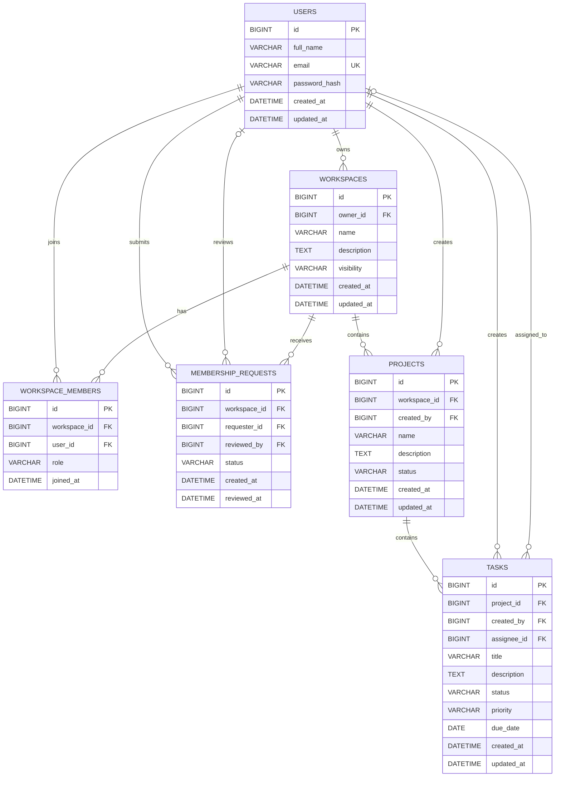

# Database Design
## Collaborative Workspace & Workflow Management Platform

**Document:** Database ERD  
**Version:** 1.0  
**Status:** Draft — MVP schema  
**Database:** MySQL 8.x  
**Storage engine:** InnoDB

---

## 1. Purpose

This document defines the initial relational database structure for the Collaborative Workspace & Workflow Management Platform. It identifies the core entities, their attributes, primary and foreign keys, and the relationships required to support the MVP.

The design is intentionally focused on the core product: user accounts, workspaces, membership, projects, and tasks. Features such as configurable approval workflows, comments, notifications, and activity history are planned as later extensions.

## 2. Scope of the MVP schema

| Area | Included capability |
|---|---|
| Accounts | User identity and authentication data |
| Workspaces | Workspace creation, visibility, and ownership |
| Membership | Workspace roles and membership requests |
| Projects | Projects organised inside workspaces |
| Tasks | Tasks organised inside projects, with optional assignees |

### Core design rules

1. A user may own more than one workspace.
2. A workspace has exactly one owner.
3. A user may participate in multiple workspaces.
4. A project belongs to exactly one workspace.
5. A task belongs to exactly one project.
6. A task may be unassigned; if assigned, the assignee must belong to the project’s workspace or be its owner.
7. Joining a private workspace requires an approved membership request.

## 3. Entity relationship diagram

The diagram below shows the MVP entities and their foreign-key relationships.

## 4. Entity definitions

### 4.1 `users`

Stores registered platform accounts. A user can own workspaces, join workspaces, submit membership requests, create projects, and create or be assigned tasks.

| Column | Suggested type | Constraints | Description |
|---|---|---|---|
| `id` | BIGINT | PK, AUTO_INCREMENT | Unique user identifier |
| `full_name` | VARCHAR(100) | NOT NULL | User’s display name |
| `email` | VARCHAR(255) | NOT NULL, UNIQUE | Login email |
| `password_hash` | VARCHAR(255) | NOT NULL | Securely hashed password |
| `created_at` | DATETIME | NOT NULL | Account creation time |
| `updated_at` | DATETIME | NOT NULL | Last account update time |

### 4.2 `workspaces`

Stores workspaces created by users. The `owner_id` foreign key is the single source of truth for workspace ownership.

| Column | Suggested type | Constraints | Description |
|---|---|---|---|
| `id` | BIGINT | PK, AUTO_INCREMENT | Unique workspace identifier |
| `owner_id` | BIGINT | FK → `users.id`, NOT NULL | Workspace owner |
| `name` | VARCHAR(120) | NOT NULL | Workspace name |
| `description` | TEXT | NULL | Workspace description |
| `visibility` | VARCHAR(20) | NOT NULL | `PUBLIC` or `PRIVATE` |
| `created_at` | DATETIME | NOT NULL | Creation time |
| `updated_at` | DATETIME | NOT NULL | Last update time |

**Ownership decision:** The owner is not duplicated as a row in `workspace_members`. The application obtains ownership from `workspaces.owner_id` and applies owner permissions from that relationship. `workspace_members` stores the other members.

### 4.3 `workspace_members`

Stores users who have joined a workspace and their workspace-level roles.

| Column | Suggested type | Constraints | Description |
|---|---|---|---|
| `id` | BIGINT | PK, AUTO_INCREMENT | Membership identifier |
| `workspace_id` | BIGINT | FK → `workspaces.id`, NOT NULL | Joined workspace |
| `user_id` | BIGINT | FK → `users.id`, NOT NULL | Member account |
| `role` | VARCHAR(30) | NOT NULL | `ADMIN`, `PROJECT_MANAGER`, or `MEMBER` |
| `joined_at` | DATETIME | NOT NULL | Date membership began |

**Required constraint:** `UNIQUE (workspace_id, user_id)` prevents duplicate membership rows.

### 4.4 `membership_requests`

Stores requests from users who want to join workspaces. The reviewer is nullable until a workspace owner or authorised administrator reviews the request.

| Column | Suggested type | Constraints | Description |
|---|---|---|---|
| `id` | BIGINT | PK, AUTO_INCREMENT | Request identifier |
| `workspace_id` | BIGINT | FK → `workspaces.id`, NOT NULL | Requested workspace |
| `requester_id` | BIGINT | FK → `users.id`, NOT NULL | User submitting the request |
| `reviewed_by` | BIGINT | FK → `users.id`, NULL | User who reviewed the request |
| `status` | VARCHAR(20) | NOT NULL | `PENDING`, `APPROVED`, `REJECTED`, or `CANCELLED` |
| `created_at` | DATETIME | NOT NULL | Request submission time |
| `reviewed_at` | DATETIME | NULL | Review time |

**Application rule:** On approval, create the corresponding `workspace_members` row and update the request status in one database transaction. Prevent duplicate pending requests in the service layer.

### 4.5 `projects`

Stores projects within a workspace. Projects provide the organisational level to which tasks belong.

| Column | Suggested type | Constraints | Description |
|---|---|---|---|
| `id` | BIGINT | PK, AUTO_INCREMENT | Project identifier |
| `workspace_id` | BIGINT | FK → `workspaces.id`, NOT NULL | Parent workspace |
| `created_by` | BIGINT | FK → `users.id`, NOT NULL | User who created the project |
| `name` | VARCHAR(150) | NOT NULL | Project name |
| `description` | TEXT | NULL | Project details |
| `status` | VARCHAR(20) | NOT NULL | `ACTIVE`, `COMPLETED`, or `ARCHIVED` |
| `created_at` | DATETIME | NOT NULL | Creation time |
| `updated_at` | DATETIME | NOT NULL | Last update time |

### 4.6 `tasks`

Stores work items belonging to projects. `assignee_id` is nullable so a task can be created before someone is assigned.

| Column | Suggested type | Constraints | Description |
|---|---|---|---|
| `id` | BIGINT | PK, AUTO_INCREMENT | Task identifier |
| `project_id` | BIGINT | FK → `projects.id`, NOT NULL | Parent project |
| `created_by` | BIGINT | FK → `users.id`, NOT NULL | User who created the task |
| `assignee_id` | BIGINT | FK → `users.id`, NULL | Assigned user |
| `title` | VARCHAR(200) | NOT NULL | Task title |
| `description` | TEXT | NULL | Task details |
| `status` | VARCHAR(20) | NOT NULL | `TODO`, `IN_PROGRESS`, `REVIEW`, or `COMPLETED` |
| `priority` | VARCHAR(20) | NOT NULL | `LOW`, `MEDIUM`, `HIGH`, or `URGENT` |
| `due_date` | DATE | NULL | Optional due date |
| `created_at` | DATETIME | NOT NULL | Creation time |
| `updated_at` | DATETIME | NOT NULL | Last update time |

## 5. Relationship and cardinality reference

| Parent entity | Child entity | Relationship | Meaning |
|---|---|---|---|
| `users` | `workspaces` | 1 : N | One user can own multiple workspaces |
| `users` | `workspace_members` | 1 : N | One user can join multiple workspaces |
| `workspaces` | `workspace_members` | 1 : N | One workspace can have multiple members |
| `users` | `membership_requests` | 1 : N | One user can submit multiple requests |
| `workspaces` | `membership_requests` | 1 : N | One workspace can receive multiple requests |
| `workspaces` | `projects` | 1 : N | One workspace can contain multiple projects |
| `users` | `projects` | 1 : N | One user can create multiple projects |
| `projects` | `tasks` | 1 : N | One project can contain multiple tasks |
| `users` | `tasks` | 1 : N | One user can create multiple tasks |
| `users` | `tasks` | 0..1 : N | A task may have no assignee or one assignee |

## 6. Integrity rules and implementation notes

### Database-enforced rules

- Primary keys uniquely identify every record.
- `users.email` must be unique.
- Every workspace must reference an existing owner.
- Every membership must reference an existing workspace and user.
- A user can appear only once in a workspace membership list.
- Every project must reference an existing workspace and creator.
- Every task must reference an existing project and creator.
- A task may have a null assignee; otherwise, the assignee must reference an existing user.

### Backend validation rules

Some rules involve more than one table and should be validated by the service layer, with transactions where multiple records change:

- Only authorised users can create projects or manage workspace membership.
- Only authorised reviewers can approve or reject membership requests.
- An approved request must result in one membership record.
- A task assignee must be the workspace owner or a member of the workspace containing the task’s project.
- A user must not submit another active pending request for the same workspace.
- Workspace ownership changes must be handled as a dedicated operation.

### Suggested indexes

| Table | Index | Reason |
|---|---|---|
| `users` | UNIQUE (`email`) | Login and duplicate prevention |
| `workspaces` | (`owner_id`) | Find workspaces owned by a user |
| `workspace_members` | UNIQUE (`workspace_id`, `user_id`) | Prevent duplicate memberships and find a user's workspace membership |
| `workspace_members` | (`user_id`) | List workspaces joined by a user |
| `membership_requests` | (`workspace_id`, `status`) | Review requests for a workspace |
| `membership_requests` | (`requester_id`, `status`) | Find a user's requests |
| `projects` | (`workspace_id`, `status`) | List projects in a workspace |
| `tasks` | (`project_id`, `status`) | List and filter project tasks |
| `tasks` | (`assignee_id`, `status`) | List a user's assigned tasks |

## 7. Planned extensions — not part of the MVP

The following capabilities should be modelled when those features are ready for implementation:

| Future capability | Potential entities |
|---|---|
| Configurable approvals | `approval_workflows`, `approval_stages`, `approval_requests`, `approval_actions` |
| Task discussions | `task_comments` |
| Notifications | `notifications` |
| Audit trail | `activity_logs` |
| Workspace invitations | `workspace_invitations` |

These are intentionally excluded from the MVP ERD so that the first implementation remains focused and testable.

## 8. Design decisions to confirm before SQL implementation

1. **Workspace member roles:** Confirm whether `ADMIN`, `PROJECT_MANAGER`, and `MEMBER` are sufficient for the first release.
2. **Membership request history:** Decide whether users may submit a new request after rejection or cancellation. The proposed design preserves request history by allowing multiple request records and enforcing only one pending request at a time in the backend.
3. **Deletion policy:** Prefer archiving workspaces and projects before considering permanent deletion. Define task and membership behaviour before implementing cascading deletes.
4. **Task assignment:** Enforce workspace membership validation in the backend before assigning a task.

---

**End of document**
